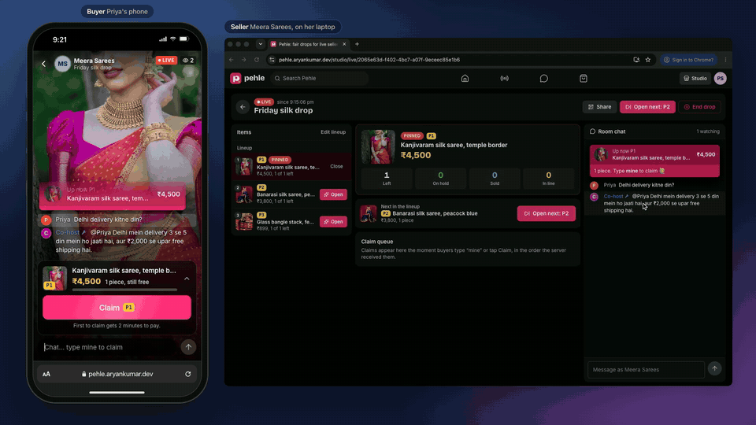
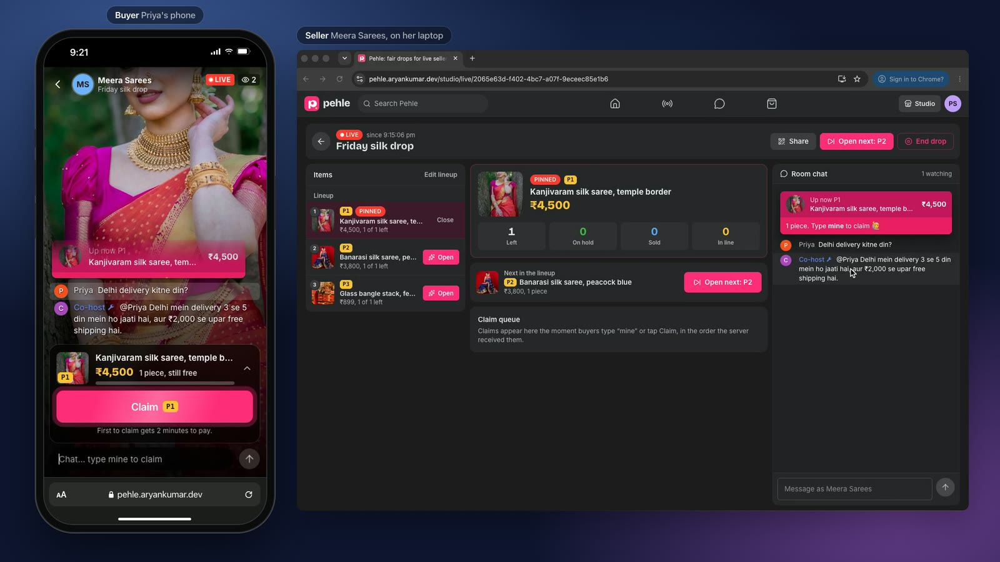
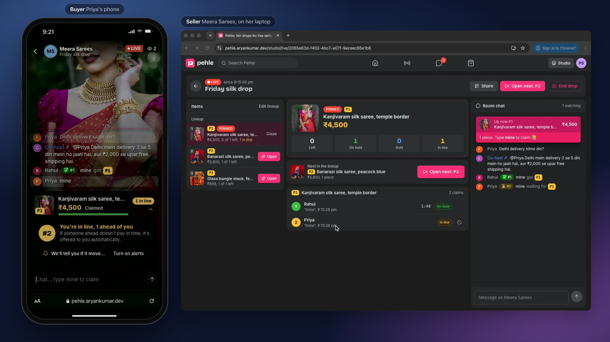
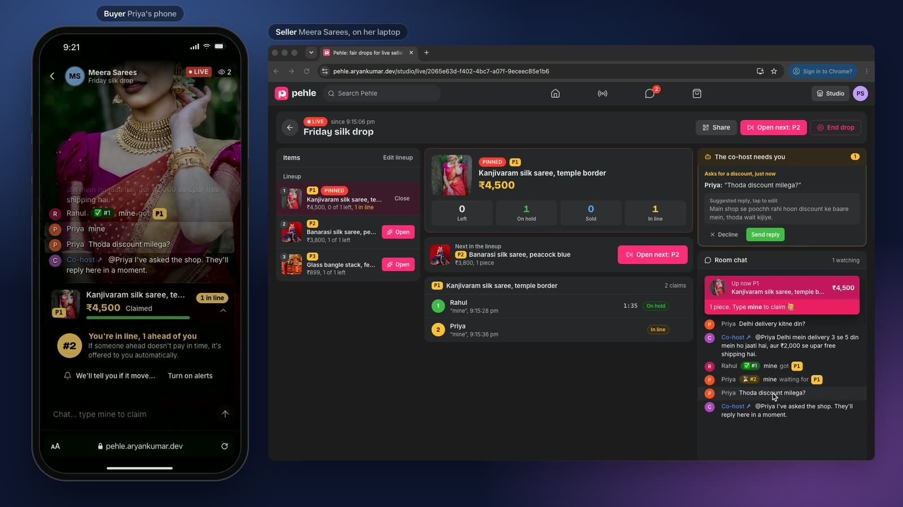
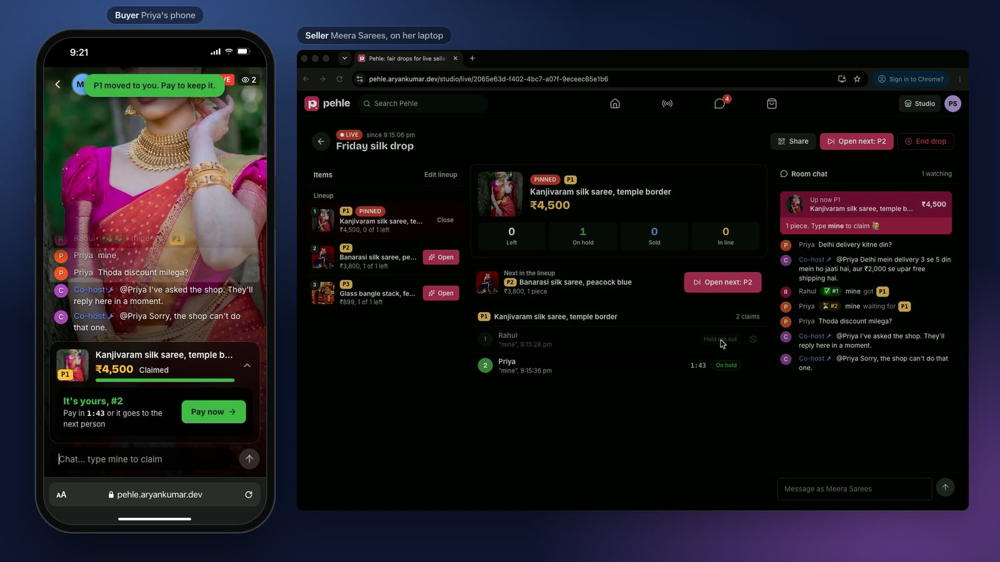
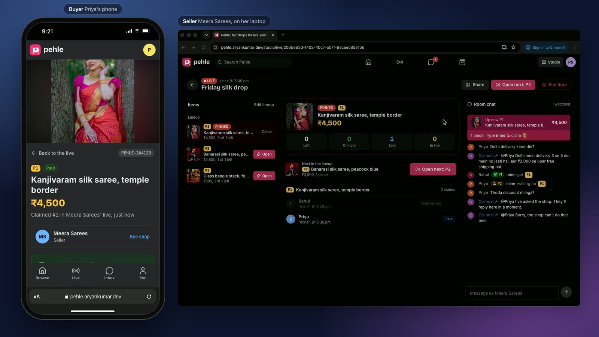
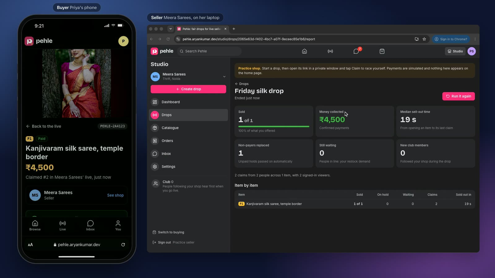
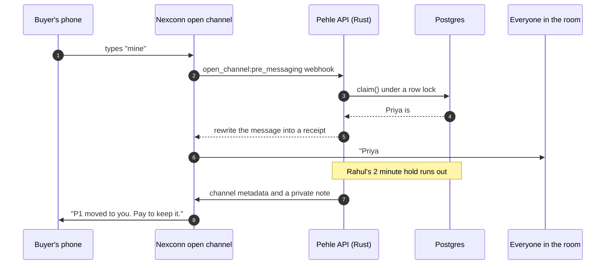
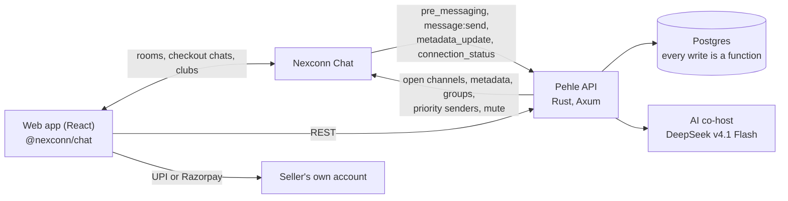

<p align="center"></p>
<h1 align="center">Pehle</h1>
<p align="center"><b>Fair live drops for India's live sellers.</b><br>Buyers type "mine" in the live chat. Pehle decides who was first before anyone sees the message.</p>
<p align="center">
  <a href="https://pehle.aryankumar.dev/try"></a>
  <a href="https://youtu.be/i4_FoM_UAE8"></a>
  
  
  
</p>

<p align="center"></p>

**Fair drops for India's live sellers and creators.** A seller pins one Pehle link during their
YouTube or Instagram live. When 40 people want the same saree, Pehle decides who was first in
milliseconds, gives the winner a timed payment window, and hands the piece to the next person in line
automatically if they don't pay. No more scrolling comments to find who said "sold" first, and no
more chasing buyers who go silent.

*Pehle aao, pehle pao*: first come, first served.

- Live: https://pehle.aryankumar.dev (judges start at https://pehle.aryankumar.dev/try, no sign-in)
- Demo video: https://youtu.be/i4_FoM_UAE8
- Nexconn App Key: `uwd1c0sxumo71`

## What it looks like

| | |
|---|---|
| <br>**AI co-host.** Priya asks "Delhi delivery kitne din?" and the co-host answers in Hinglish from the shop's shipping policy. | <br>**The line.** Rahul typed "mine" first, Priya second. The seller's console shows the same order the room sees. |
| <br>**Money stays with the seller.** "Thoda discount milega?" becomes a one-tap approval; the co-host promises nothing. | <br>**The line moves itself.** Rahul didn't pay in 2 minutes, so the saree moved to Priya without the seller doing anything. |
| <br>**Paid to the seller.** Priya pays the shop directly, the seller taps Received, and her phone shows Paid. | <br>**The report.** What sold, money collected, holds passed on and restock demand. |

## Judge path (about 3 minutes)

| Step | What you should see |
|---|---|
| 1. Open `/try` and tap **Start the race** | A drop room with one saree and four scripted buyers. No sign-in. |
| 2. Tap **Claim**, or type `mine` in the chat | Your receipt in the chat with your place in line, decided by the server. |
| 3. Wait about 40 seconds | The buyers ahead don't pay. Their holds run out and the piece moves to you on its own. |
| 4. **Go to checkout**, **Fill in test details**, **I've paid** | The demo seller confirms in a few seconds. Nothing is charged. |
| 5. **See the fairness log** | Every claim, hold, lapse and payment, with its time and source. |
| 6. Back on `/try`, **Open my practice shop** | Your own seller studio with sample items and shop policies. |
| 7. Create a drop, **Go live**, **Open next**. Open the room link in a private window and type `Delhi delivery kitne din?`, then `mine` | The AI co-host answers from the shop's policies; the claim lands in the console's claim queue. Ask `Thoda discount milega?` and the seller gets a one-tap approval. |

## Try it

- **Demo drop**: open `/try` and race four rival buyers for one piece. Nobody is charged.
- **Browse**: `/` shows drops that are live now, starting soon, and items you can claim.
- **Sell**: `/studio` lists items, announces a drop with a lineup, shares the link, runs the live
  console and shows a report afterwards.

## How it works

1. **Drop.** Buyers claim in the drop's Nexconn open channel by typing "mine", an item code, or
   tapping Claim. Every claim passes through our `open_channel:pre_messaging` webhook, where Postgres
   orders it under a row lock. The message is rewritten into a receipt everyone sees ("Ananya claimed
   S12, #1"); deep places in line are told privately so a big room stays readable. Room state
   (pinned item, units left, waitlist) is synced through open channel metadata that only the server
   can write.
2. **Pay.** The winner's checkout card arrives in their private conversation with the shop (a
   Nexconn group with the buyer, the shop team and the shop's AI co-host). Payment goes to the
   seller's own Razorpay or UPI. If the hold runs out, the next buyer is promoted and notified, the
   old payment link is cancelled, and a late payment is refunded. Free items (a creator's coupons or
   cohort seats) are won instantly and reveal a private winner note.
3. **Come back.** Buyers join a shop's club, tap "Remind me" on upcoming drops, and get browser
   notifications when a drop starts or an item moves to them. Each shop has a public record computed
   from real claims and payments. After every drop the seller gets a report: sell-through, money
   collected, non-payers replaced, and how many people are still waiting (restock demand).

A claim, from the buyer's phone to the whole room:



The AI co-host answers price, size, delivery and returns questions in the buyer's language, from the
shop's own policies and live stock, and never promises discounts or exceptions: those become one-tap
approvals for the seller.

## Built on Nexconn

Open channels per drop, the `open_channel:pre_messaging` webhook, open channel metadata with tamper
revert, priority senders and high-priority messages, group channels for buyer-shop conversations and
shop clubs, a lobby open channel for the home page's live activity feed, `message:send` and
connection webhooks for inbox ordering and traction, and server-issued tokens (the App Secret never
reaches a browser). Details in [ARCHITECTURE.md](ARCHITECTURE.md).



| Nexconn feature | What Pehle uses it for | Code |
|---|---|---|
| Chat SDK (`@nexconn/chat`, `NCEngine`) | Drop rooms, checkout chats and clubs in the web app | [apps/web/src/lib/chat.ts](apps/web/src/lib/chat.ts), [useChat.ts](apps/web/src/lib/useChat.ts) |
| Open channel per drop | The live drop room | [workers.rs](crates/pehle-api/src/workers.rs), [studio.rs](crates/pehle-api/src/routes/studio.rs) |
| `open_channel:pre_messaging` webhook | Every "mine" is ranked in Postgres before it is delivered; phone numbers and handles are masked before delivery | [webhooks.rs](crates/pehle-api/src/routes/webhooks.rs), [privacy.rs](crates/pehle-api/src/privacy.rs) |
| Open channel metadata and `metadata_update` webhook | Pinned piece, units left and the line on every phone; writes by anyone but the server are reverted | [workers.rs](crates/pehle-api/src/workers.rs), [webhooks.rs](crates/pehle-api/src/routes/webhooks.rs) |
| Priority senders | The shop's and co-host's messages stay visible in a busy room | [studio.rs](crates/pehle-api/src/routes/studio.rs) |
| Mute participant | The seller's Block mutes that buyer in the room | [studio.rs](crates/pehle-api/src/routes/studio.rs) |
| Group channels | A private checkout chat per buyer and shop; a club per shop | [workers.rs](crates/pehle-api/src/workers.rs) |
| `message:send` webhook | The AI co-host answers inside checkout chats; inbox ordering | [webhooks.rs](crates/pehle-api/src/routes/webhooks.rs), [cohost.rs](crates/pehle-api/src/cohost.rs) |
| `user:connection_status` webhook | Counts the real people who used Pehle for `/stats` | [webhooks.rs](crates/pehle-api/src/routes/webhooks.rs) |
| Lobby open channel | The home page's live activity feed | [workers.rs](crates/pehle-api/src/workers.rs), [live-feed.tsx](apps/web/src/components/live-feed.tsx) |
| Server API tokens and user profiles | Tokens issued by our server, so the App Secret never reaches a browser; buyer names synced to Nexconn | [state.rs](crates/pehle-api/src/state.rs), [session.rs](crates/pehle-api/src/routes/session.rs) |

## Proof

- Chat claims, ranked before delivery: in https://pehle.aryankumar.dev/fair/32b59aba two buyers typed
  "mine" in the room chat. Both claims show source "chat". The server decided Rahul's claim 272 ms
  after Nexconn received his message and Priya's 35 ms after, before either message reached the room.
  Rahul didn't pay, his 2 minute hold ran out, the saree moved to Priya, and she paid.
- Race test on the live site, Nov 22 2026: 200 buyers claimed one 10-piece item at the same moment.
  Exactly 10 holds, at places 1 to 10; places 1 to 200 unique with no gaps; 0 failed claims; all 200
  claims in 4.8 s from one laptop. Details in [docs/RACE-TEST.md](docs/RACE-TEST.md); rerun with
  `bun scripts/race-test.ts 200 10`.
- The race test sends claims through the Claim button path, which runs the same Postgres function as
  chat claims. Fairness log of that drop: https://pehle.aryankumar.dev/fair/09b03ee7

## Engineering

- Rust (Axum, sqlx) and Postgres 17. **Every write is a Postgres function**; the API's connections run
  as a role that cannot write tables directly. SQL lives in three files: schema, functions, access.
- Types flow from SQL to Rust (compile-time checked) to OpenAPI to a generated TypeScript client.
- 59 Rust tests, including a 60-buyer race, webhook retries, hold expiry and promotion, late and
  short payments, YouTube identity merging, demo isolation, and the role's write restrictions. The
  database tests run as the restricted API role.
- `bun scripts/load-test.ts 2000 10` (local, debug build): 2,000 buyers claiming 10 units at the same
  instant gave exactly 10 holds at positions 1 to 10, unique contiguous positions 1 to 2,000, and zero
  errors, in 2.9 s.
- Phone sign-in (Firebase ID tokens verified against Google's keys) and Web Push (VAPID, RFC 8291)
  are implemented with `ring`, with round-trip tests.

## Run locally

```sh
bun install
bun run db:up                      # Postgres in Docker on port 54329
cp .env.example .env               # dev sign-in on, no external keys needed
bash scripts/restart-api.sh        # build and start the API on :8790, regenerate the TS client
cd apps/web && bunx vite           # http://localhost:5173
bun scripts/seed-demo.ts           # three shops, a live drop and upcoming drops
```

Without a Nexconn key the app runs in preview mode: chat calls are logged, and the room works through
the API. [docs/KEYS.md](docs/KEYS.md) lists every key and console setting for production.

## Deploy

One server: `docker compose -f infra/compose.yml --env-file infra/.env.production up -d --build`
runs Postgres, the API and Caddy (TLS, web app, media, link previews).
